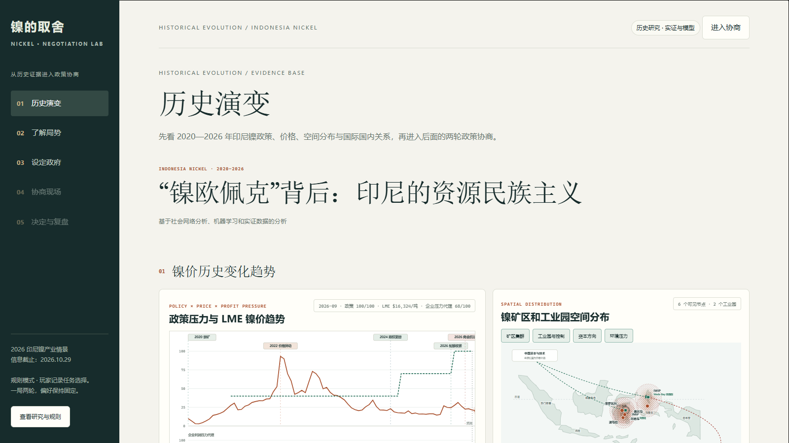

# Behind the "Nickel OPEC": Indonesia's Resource Nationalism

**A social-network, machine-learning, and empirical analysis of Indonesia's nickel policy and multi-actor strategic bargaining.**



[Live Demo](https://yangyr56.github.io/Nickel-Trade-offs-LLM-based-Multi-agent-Game-Simulation/) ·
[Chinese README](README.zh-CN.md) ·
[Pages Workflow](https://github.com/yangyr56/Nickel-Trade-offs-LLM-based-Multi-agent-Game-Simulation/actions/workflows/pages.yml)


## Overview

This project examines how structural pressure in the global nickel market is translated into Indonesian policy through domestic coalition politics, strategic perception, and state capacity. It combines two connected experiences:

1. **Historical evidence reproduction** - policy pressure, nickel prices, spatial production networks, international supply-demand exposure, and domestic political networks.
2. **Strategic negotiation simulation** - a two-round policy table where the central government and four stakeholder groups exchange proposals, conditions, and implementation commitments.

The project is built for research communication, teaching, and competition demonstration. It is not a forecast of real policy outcomes or a ranking of national welfare.

## Live Demo

**Website:**  
https://yangyr56.github.io/Nickel-Trade-offs-LLM-based-Multi-agent-Game-Simulation/

The GitHub Pages version supports the historical evidence modules and the rule-based negotiation mode.

The optional DeepSeek-powered multi-agent mode requires a Node.js server and secure server-side API credentials. It is not available on GitHub Pages alone.

## Classroom Format

Nickel Trade-off can be run as a digital exercise or a facilitated classroom simulation.

### Stakeholder seats

- **Mining companies:** protect output, contracts, and investment recovery while requesting a transition period.
- **Smelters and downstream industries:** maintain ore supply and utilization of existing processing capacity.
- **Local governments:** protect fiscal revenue, employment, public services, and transition resources.
- **Affected communities:** protect employment, environmental quality, health, land, and participation channels.
- **Central coordinator / facilitator:** propose policy packages, mediate trade-offs, and verify implementation conditions.

### Negotiation agenda

1. Magnitude and pace of the nickel RKAB quota reduction
2. Allocation of transition costs
3. Training and public-service support for industrial transformation

### Recommended rules

- Classroom format: three negotiation rounds plus a final resolution vote
- Digital demo: a two-round negotiation followed by the central coordinator's decision
- A valid resolution must be acceptable to most actors and pass legal, resource, and cooperation checks
- If no agreement is reached, the government may impose a unilateral quota plan with distributional consequences

## Core Modules

### 01. Historical Evolution

The historical module is divided into three sections:

- **Nickel price and policy pressure**
  - Monthly LME nickel prices from 2020 to 2026
  - Historical policy pressure index
  - Corporate profit-pressure proxy
  - Huber-Ridge ARX scenario forecasts with 95% intervals
  - Key policy and market events, including the 2020 ore export ban, the 2022 nickel-market dislocation, the 2024 political transition, and the 2026 quota tightening

- **Spatial distribution**
  - Nickel mining and processing clusters in Sulawesi, Maluku, and Halmahera
  - IMIP and IWIP industrial parks
  - Publicly documented ownership and project-control relations
  - Capital-flow and environmental-pressure layers, clearly marked as schematic

- **International system and domestic politics**
  - Supply-demand relations among major producing and consuming countries
  - Country flags, production and consumption shares, and weighted structural links
  - Relative gain/loss exposure to a tightening nickel market
  - Four-layer domestic governance network:
    - formal authority
    - capital relations
    - domestic implementation
    - social legitimacy
  - A fixed side panel describing every network layer, actor, and strongest relation

### 02-05. Strategic Negotiation Simulation

Players act as Indonesia's central policy coordinator and move through four stages:

1. **Understand the situation**
2. **Set the government strategy**
3. **Negotiate with stakeholder groups**
4. **Decide and review implementation conditions**

The stakeholder actors are:

- licensed mining and processing firms
- smelters and downstream processors
- local governments in producing regions
- affected communities and environmental interests

Each round connects:

- policy clauses and distributional effects
- stakeholder support or opposition
- conditional requests and commitments
- budget, capacity, legal, and cooperation checks

## Required Historical Briefing

The website opens with a required briefing that players must acknowledge before interacting with the simulation. It explains the causal logic:

> International structural constraints -> domestic interest-group bargaining -> Indonesian nickel quota policy

The briefing covers:

- Indonesia's structural position in the global nickel and battery supply chain
- constraints from ESG rules, carbon-border measures, trade disputes, and concentrated downstream capital
- the goals and concerns of the state, mining firms, processors, local governments, and communities
- the central trade-off between supply-chain leverage and domestic economic, fiscal, and social costs

## Research Framework

The project follows a neoclassical-realist transmission chain:

```text
Systemic pressure and opportunity
        |
        v
Domestic political filtering
        |
        v
Strategic perception
        |
        v
State capacity
        |
        v
Strategic behavior and policy choice
```

This framework separates:

- external constraints from domestic political mediation
- state intentions from implementation capacity
- policy announcements from actual stakeholder commitments
- statistical associations from established causal claims

## Data and Evidence

The current V2 knowledge base includes:

- `KB-20261030-3`
- `policy-quota-v3`
- 85 observation rows
- 19 supplemental local-community evidence records
- 17 visible sources

Primary data and evidence include:

- Indonesian mining and energy regulations
- MIND ID and corporate disclosures
- IISD/IGF research on environmental and community governance
- LME monthly nickel prices
- public research estimates for 2024 nickel production and consumption shares
- publicly reported local cases, including Morowali, Bahodopi, and Kabaena

The domestic governance network is a cumulative snapshot covering **2024-01-01 to 2026-10-27**. It includes seven aggregated actors and 18 directed, signed, weighted relations, of which 13 are A/B-confidence core edges and five are background edges.

## Methods

### Social Network Analysis

- Directed and signed multi-layer networks
- Weighted in-degree and out-degree
- Betweenness centrality
- Positive edges for authorization, support, resources, ownership, or cooperation
- Negative edges for constraints, penalties, environmental pressure, or accountability
- A/B core edges used for principal centrality calculations
- C-level evidence retained only as background relations

### Machine Learning

The price scenario module uses a direct multi-horizon **Huber-Ridge ARX** model:

- target: future 1-3 month log returns
- inputs: price momentum, policy pressure, and policy-event direction
- expanding-window out-of-sample testing
- Huber loss to reduce the influence of the 2022 nickel-market outlier
- ridge regularization for a small monthly sample
- 95% intervals based on rolling out-of-sample residual quantiles

The forecast is presented as a scenario, not a high-confidence price prediction or investment recommendation.

### LLM-Assisted Negotiation

When enabled, the server can use DeepSeek to:

- propose a central policy package
- let each stakeholder actor respond independently
- generate conditions, requests, and task commitments
- produce a second-round policy proposal after reading public first-round feedback

The model does not replace rule-calculated policy impacts, evidence IDs, resource limits, or implementation checks.

## Data Integrity and AI Guardrails

- API keys are never included in the client application.
- `.env` files are excluded from Git.
- Model-generated source IDs are validated against the approved knowledge base.
- The model cannot replace rule-defined impact directions.
- Unsupported quantitative claims are rejected.
- Missing cooperation remains pending instead of being treated as consent.
- A policy is not considered implementable merely because actors verbally support it.

## Technology Stack

- Vanilla HTML, CSS, and JavaScript
- SVG visualizations for maps, networks, and charts
- Node.js 22+
- Serverless-compatible worker bundle
- Optional DeepSeek API integration
- GitHub Actions and GitHub Pages

## Quick Start

### Static version

Open `public/index.html` in a browser, or run any static file server from the `public/` directory.

### Full local version

Prerequisites:

- Node.js 22 or newer

```powershell
Copy-Item .env.example .env
npm start
```

Then open:

```text
http://127.0.0.1:8080
```

The rule-based simulation works without an API key. To enable live LLM negotiation, configure the server-side environment values in `.env`.

### Environment Variables

| Variable | Purpose |
|---|---|
| `HOST` | Local server host |
| `PORT` | Local server port |
| `APP_ORIGIN` | Expected application origin |
| `DEEPSEEK_API_KEY` | Optional server-side LLM key |
| `DEEPSEEK_MODEL` | LLM model name |
| `DEMO_PASSWORD` | Optional local demo password |
| `SESSION_SECRET` | Signed-session secret |

Never commit the real `.env` file.

## GitHub Pages Deployment

The repository includes:

```text
.github/workflows/pages.yml
```

Deployment flow:

1. Open repository `Settings -> Pages`.
2. Select `GitHub Actions` as the source.
3. Push to `main`.
4. The workflow uploads `public/` as the static site.

GitHub Pages serves only the frontend. The optional LLM API requires a separate Node-compatible hosting environment.

## Teaching Materials

| File | Purpose |
|---|---|
| [`docs/background.md`](docs/background.md) | Full historical and policy background |
| [`docs/role-briefs.md`](docs/role-briefs.md) | Complete briefs for the central coordinator and four stakeholder groups |
| [`docs/theory-guide.md`](docs/theory-guide.md) | Neoclassical-realism teaching guide and assessment rubric |
| [`docs/agenda-template.md`](docs/agenda-template.md) | Negotiation records and final resolution template |
| [`src/simulation-script.md`](src/simulation-script.md) | 90-100 minute classroom facilitation script |

Suggested classroom flow:

1. Read the background briefing.
2. Assign the four stakeholder groups and one facilitator.
3. Distribute role briefs and the resolution template.
4. Run three negotiation rounds and a final vote.
5. Use the debrief questions in the theory guide.

## Build

Rebuild the server bundle:

```powershell
npm run build
```

The generated worker is written to:

```text
dist/server/index.js
```

The deployable bundle is:

```text
server-bundle.mjs
```

## Repository Structure

```text
.
|-- public/
|   |-- index.html
|   |-- app.js
|   |-- data.js
|   |-- player-copy.js
|   |-- history.html
|   |-- history.js
|   |-- history.css
|   |-- briefing.html assets
|   |-- map and network data
|   `-- style files
|-- assets/
|   `-- cover-nickel-tradeoff.png
|-- docs/
|   |-- background.md
|   |-- role-briefs.md
|   |-- theory-guide.md
|   `-- agenda-template.md
|-- src/
|   `-- simulation-script.md
|-- knowledge/
|   |-- observations.json
|   `-- evidence and coding notes
|-- worker/
|   |-- government.mjs
|   |-- followup.mjs
|   `-- handler.mjs
|-- scripts/
|   `-- validation and audit scripts
|-- .github/workflows/pages.yml
|-- build.mjs
|-- server.mjs
|-- LICENSE
`-- server-bundle.mjs
```

## Verification

The repository includes checks for:

- interest-direction logic
- review-chart consistency
- local and community evidence retrieval
- policy-government alignment
- AI response guardrails
- follow-up validation
- required briefing behavior
- historical-module integration
- GitHub Pages deployment

Example:

```powershell
node scripts/check-interest.mjs
node scripts/check-local-community-evidence.mjs
node scripts/check-policy-government.mjs
node scripts/check-agent.mjs
node scripts/check-followup.mjs
```

## Research Boundaries

- Actors are aggregated analytical categories, not individual legal entities.
- Interest scores are researcher-coded and are not official utility functions.
- The network reflects publicly verifiable relations, not informal patronage networks.
- A missing edge means that no sufficiently verifiable public relation was found, not that no relation exists.
- The forecast is a model scenario, not a certain future price.
- Environmental circles in the map are illustrative, not measured deforestation areas.
- International supply-demand links are share-weighted structural associations, not bilateral trade volumes.
- The simulation is educational and exploratory. It does not predict real policy decisions, firm profits, or national welfare.

## Chinese Documentation

The Chinese version is available at:

- [README.zh-CN.md](README.zh-CN.md)

## License

Released under the [MIT License](LICENSE).

## Disclaimer

This is an independent research and educational prototype. It is not affiliated with the Government of Indonesia, MIND ID, Antam, the LME, any listed company, or any government agency. Nothing in this repository constitutes investment, legal, or policy advice.
